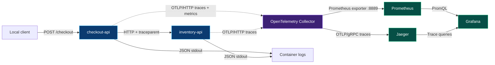

<p align="center">
  
</p>

<h1 align="center">Checkout Observability</h1>

<p align="center">
  <strong>A production-minded local observability lab for a distributed FastAPI checkout flow.</strong>
</p>

<p align="center">
  Trace one request across two services, measure its outcomes and latency, and correlate the result with structured logs.
</p>

<p align="center">
  <a href="https://www.python.org/"></a>
  <a href="https://fastapi.tiangolo.com/"></a>
  <a href="https://opentelemetry.io/"></a>
  <a href="https://docs.docker.com/compose/"></a>
  <a href="https://prometheus.io/"></a>
  <a href="https://grafana.com/"></a>
</p>

<p align="center">
  <a href="#quick-start">Quick start</a> ·
  <a href="#architecture">Architecture</a> ·
  <a href="#explore-the-signals">Explore signals</a> ·
  <a href="#verification-lab">Verification lab</a> ·
  <a href="#operations">Operations</a>
</p>

<p align="center">
  
</p>

## Why this project exists

Checkout Observability is a small, deterministic system for learning and verifying observability behavior without hiding the mechanics behind a zero-code agent. A public `checkout-api` validates a request and calls an internal `inventory-api`; both services are instrumented programmatically and run with a complete local trace and metrics pipeline.

The catalog is fixed in memory and availability checks never decrement stock. That makes repeated traffic and failure demonstrations reproducible.

| Capability | What is implemented |
| --- | --- |
| Distributed tracing | FastAPI server spans, httpx client spans, manual business spans, and W3C Trace Context propagation. |
| Application metrics | A bounded checkout counter and explicit-bucket duration histogram exported through OTLP. |
| Correlated logs | One-line JSON stdout logs with active trace and span IDs and no request-body capture. |
| Local backends | OpenTelemetry Collector, Jaeger, Prometheus, and automatically provisioned Grafana. |
| Failure lab | Deterministic slow, simulated failure, out-of-stock, Collector outage, backend outage, and recovery scenarios. |
| Reproducible checks | Locked dependencies, pinned container images, 28 application tests, bounded verification scripts, and CI smoke tests. |

## Quick start

### Prerequisites

- A maintained Fedora release with Docker Engine and Docker Compose v2.
- OpenSSL for local Grafana credential generation.
- `curl` for the API examples.
- Python 3.11–3.14 only when running tests and scripts from the host; CI uses Python 3.13.

Clone the repository, create a local environment, generate a password without printing it, then start the stack:

```bash
git clone https://github.com/OWNER/checkout-observability.git
cd checkout-observability

python3.13 -m venv .venv
.venv/bin/python -m pip install --requirement requirements.lock

install -d -m 700 .local-secrets
umask 077
openssl rand -hex 32 | tr -d '\n' > .local-secrets/grafana_admin_password

docker compose up --build --detach --wait --wait-timeout 180
```

> [!NOTE]
> The Compose bind mounts already use private `:Z` SELinux labels for Fedora. Do not disable SELinux or the firewall.

Submit a checkout:

```bash
curl --request POST http://127.0.0.1:8000/checkout \
  --header 'content-type: application/json' \
  --data '{"product_id":"SKU-001","quantity":2,"scenario":"normal"}'
```

Expected response:

```json
{
  "status": "ok",
  "service": "checkout-api",
  "data": {
    "checkout_status": "accepted",
    "product_id": "SKU-001",
    "quantity": 2
  }
}
```

### Local endpoints

| Surface | URL | Exposure |
| --- | --- | --- |
| Checkout API | <http://127.0.0.1:8000> | Published on loopback only. |
| OpenAPI UI | <http://127.0.0.1:8000/docs> | Published on loopback only. |
| Grafana | <http://127.0.0.1:3000> | Published on loopback only. |
| Prometheus | <http://127.0.0.1:9090> | Published on loopback only. |
| Jaeger | <http://127.0.0.1:16686> | Published on loopback only. |
| Inventory API | `inventory-api:8001` | Internal Compose network only. |
| OTLP receiver | `otel-collector:4318` | Internal Compose network only. |

Sign in to Grafana as `admin` with the password stored in the ignored `.local-secrets/grafana_admin_password` file.

## Architecture



### Component responsibilities

| Component | Responsibility |
| --- | --- |
| `checkout-api` | Validates checkout input, owns `checkout.process`, calls inventory, and records request metrics. |
| `inventory-api` | Looks up a fixed catalog and owns `inventory.lookup`. Availability checks do not mutate stock. |
| OpenTelemetry Collector | Receives OTLP/HTTP, applies memory limiting before batching, exports traces, and exposes application metrics. |
| Jaeger | Stores and displays local distributed traces using transient in-memory storage. |
| Prometheus | Scrapes the Collector's application-metrics exporter and stores local time series. |
| Grafana | Provisions Prometheus and Jaeger data sources plus the `Checkout Observability` dashboard. |

### One checkout, one connected trace

```text
POST /checkout                         checkout-api server span
└── checkout.process                   manual business span
    └── POST                           httpx client span
        └── POST /check                inventory-api server span
            └── inventory.lookup       manual business span
```

The client span injects a W3C `traceparent` header and the inventory server span extracts it. Trace and span IDs are never copied manually.

## Scenario matrix

Local simulations require both `APP_ENV=local` and `ENABLE_LOCAL_SIMULATIONS=true`; Compose enables them only for this development stack.

| Scenario | Inventory behavior | Checkout status | Metric outcome |
| --- | --- | ---: | --- |
| `normal` | Immediate catalog lookup | `200` | `accepted` |
| `slow` | Adds a one-second local delay | `200` | `accepted` |
| `error` | Returns an explicit simulated failure | `503` | `inventory_unavailable` |
| `out-of-stock` | Returns unavailable without mutating stock | `409` | `out_of_stock` |

Example failure request:

```bash
curl --include --request POST http://127.0.0.1:8000/checkout \
  --header 'content-type: application/json' \
  --data '{"product_id":"SKU-001","quantity":2,"scenario":"error"}'
```

## Explore the signals

### Traces

Open Jaeger, select `checkout-api`, and search for `checkout.process`. A normal trace contains both service identities and all five spans shown above. Error spans record bounded outcome attributes and OpenTelemetry error status without capturing bodies, credentials, or product identifiers.

Full local trace capture is the default. Parent-aware 25% head sampling can be demonstrated with:

```bash
OTEL_TRACES_SAMPLER=parentbased_traceidratio \
OTEL_TRACES_SAMPLER_ARG=0.25 \
docker compose up --detach --force-recreate --wait inventory-api checkout-api
```

Sampling affects traces, not the custom checkout metrics.

### Metrics

The checkout service exports exactly two custom instruments:

| Prometheus name | Type | Unit | Included requests |
| --- | --- | --- | --- |
| `checkout_requests_total` | Counter | requests | Every validated request after the handler starts. |
| `checkout_request_duration_seconds` | Explicit-bucket histogram | seconds | The same validated requests, including non-accepted outcomes. |

Only bounded `outcome` and `result` attributes become labels. Customer IDs, order IDs, trace IDs, span IDs, product IDs, and raw URLs are not labels. FastAPI validation failures produced before the handler, including `422`, are excluded.

The provisioned dashboard contains:

- checkout request rate;
- non-accepted outcome ratio;
- checkout latency P95 calculated from the exported histogram buckets.

Representative PromQL:

```promql
sum(rate(checkout_requests_total[1m]))

sum(rate(checkout_requests_total{result="error"}[1m]))
/
sum(rate(checkout_requests_total[1m]))

histogram_quantile(
  0.95,
  sum by (le) (rate(checkout_request_duration_seconds_bucket[1m]))
)
```

### Correlated logs

```bash
docker compose logs --since 5m checkout-api inventory-api
```

Application events are emitted through Python logging as one-line JSON records. Each record contains a timestamp, severity, service identity, bounded outcome fields, duration, and the active trace and span IDs. Records outside an active span contain null correlation IDs, preventing context from leaking between requests.

Paste a log's `trace_id` into Jaeger to locate the corresponding trace. These records remain container stdout; this project does not include an OTLP logs pipeline, Loki, or durable log retention.

## Verification lab

### Generate a deterministic traffic mix

```bash
.venv/bin/python scripts/traffic.py \
  --target-url http://127.0.0.1:8000
```

The default run sends 20 finite requests with concurrency 4 and covers all four scenarios. It prints response counts and latency summaries; it is a functional demonstration, not a benchmark.

### Verify the complete stack

```bash
.venv/bin/python scripts/verify_stack.py
```

The verifier uses bounded polling to check response contracts, Collector configuration, connected traces, parent-child relationships, slow and error evidence, real metric names, PromQL results, dashboard provisioning, and log correlation.

### Demonstrate failures and recovery

```bash
.venv/bin/python scripts/demonstrate_failures.py
```

This stops and starts only project services. It demonstrates that Collector unavailability does not fail checkout requests solely because telemetry export failed, then observes backend export failures, retry behavior, and recovery.

### Demonstrate parent-aware sampling

```bash
.venv/bin/python scripts/demonstrate_sampling.py
```

This runs 200 requests with a 25% parent-aware head sampler, verifies connected sampled traces, confirms metrics still count all requests, and restores `always_on`.

> [!IMPORTANT]
> SDK and Collector queues are memory-only. Retry can bridge a short outage, but a process crash can lose buffered telemetry. No persistent queue is claimed.

## Project structure

```text
.
├── assets/                         Generated project artwork used by this README
├── grafana/provisioning/           Data sources and dashboard-as-code
├── prometheus/prometheus.yml       Collector scrape configuration
├── scripts/                        Traffic, verification, outage, and sampling tools
├── services/
│   ├── checkout_api/               Public checkout service and image definition
│   └── inventory_api/              Internal catalog service and image definition
├── shared/                         Models, configuration, logging, telemetry, and errors
├── tests/                          Application and observability-focused tests
├── compose.yaml                    Local topology, health checks, networks, and volumes
├── otel-collector-config.yaml      Trace and metrics pipelines
├── requirements.lock               Reproducible development/test dependencies
└── requirements.runtime.lock       Minimal service-image dependencies
```

## Configuration

The applications read environment variables directly; they do not load `.env` files automatically. `.env.example` contains non-sensitive defaults and placeholders only.

| Variable | Compose default | Purpose |
| --- | --- | --- |
| `APP_ENV` | `local` | Runtime environment; simulations require `local`. |
| `ENABLE_LOCAL_SIMULATIONS` | `true` | Enables slow and error scenarios in the local stack. |
| `SIMULATED_DELAY_SECONDS` | `1.0` | Inventory delay for the slow scenario. |
| `INVENTORY_API_URL` | `http://inventory-api:8001` | Internal checkout dependency URL. |
| `INVENTORY_HTTP_TIMEOUT_SECONDS` | `2.0` | Checkout-to-inventory timeout. |
| `OTEL_EXPORTER_OTLP_TRACES_ENDPOINT` | Collector `/v1/traces` | Full OTLP/HTTP trace endpoint. |
| `OTEL_EXPORTER_OTLP_METRICS_ENDPOINT` | Collector `/v1/metrics` | Full OTLP/HTTP metrics endpoint. |
| `OTEL_TRACES_SAMPLER` | `always_on` | SDK head-sampling strategy. |
| `OTEL_TRACES_SAMPLER_ARG` | empty | Optional sampling ratio. |
| `GRAFANA_ADMIN_USER` | `admin` | Local Grafana administrator name. |
| `GRAFANA_ADMIN_PASSWORD_FILE` | ignored local file | Source for Grafana's secret-file mechanism. |

## Tests and CI

```bash
.venv/bin/python -m pip check
.venv/bin/python -m compileall -q services shared scripts tests
.venv/bin/python -m pytest

docker compose config --quiet
docker compose run --rm --no-deps --entrypoint /otelcol \
  otel-collector validate --config=/etc/otelcol/config.yaml
```

The GitHub Actions workflow uses read-only repository permissions and pinned official action commits. It installs locked dependencies, checks Python compatibility, runs the test suite, validates Compose and the Collector configuration, builds both service images, starts the stack, executes the end-to-end verifier, and always stops project containers. It does not deploy or publish artifacts and requires no repository secrets.

## Operations

### Normal shutdown

This removes project containers and networks while preserving Prometheus and Grafana volumes:

```bash
docker compose down --remove-orphans
```

### Destructive project-data reset

This removes only this Compose project's containers, networks, and named volumes:

```bash
docker compose down --volumes --remove-orphans
```

The reset deletes Prometheus data, the Grafana database, and the prepared Grafana-secret volume. It does not prune global Docker resources. Jaeger traces are transient and disappear whenever Jaeger stops.

### Troubleshooting

| Symptom | Check |
| --- | --- |
| Docker daemon is unavailable | Run `sudo systemctl enable --now docker`, then `docker version`. |
| Grafana rejects the password | Reset project volumes, regenerate the ignored password file, and start again. The password is applied when Grafana initializes its database. |
| Grafana takes time on first boot | A new database performs hundreds of migrations; keep the documented 180-second bounded startup deadline. |
| Metrics are not visible immediately | Metrics export every five seconds and Prometheus scrapes every two seconds. Generate traffic and run the verifier. |
| Ratio sampling produces no trace | Head sampling is probabilistic. Restore `OTEL_TRACES_SAMPLER=always_on` when every local trace is required. |
| Fedora denies a bind mount | Keep the repository's `:Z` labels and inspect SELinux audit output; do not disable SELinux. |
| A browser port is occupied | Inspect listeners on `8000`, `3000`, `9090`, and `16686`. |

## Pinned versions

| Dependency or image | Version |
| --- | --- |
| Python container | `3.13.16-slim-bookworm` |
| FastAPI | `0.140.10` |
| httpx | `0.28.1` |
| Uvicorn | `0.53.0` |
| OpenTelemetry API, SDK, OTLP exporter | `1.45.1` |
| OpenTelemetry FastAPI and httpx instrumentation | `0.66b1` |
| OpenTelemetry Collector | `0.162.0` |
| Jaeger | `2.22.0` |
| Prometheus | `3.15.1` |
| Grafana | `13.3.0` |

Python dependencies are fully resolved in both lock files. Container images are pinned by version and multi-platform digest in `compose.yaml` and the service Dockerfiles.

## Security boundaries

- Browser-facing ports bind to `127.0.0.1`; inventory and OTLP ports remain internal.
- Application containers run as non-root users with read-only filesystems and dropped capabilities.
- Grafana reads its generated password through a secret file; the value is not committed, copied into images, or placed in Compose.
- Request bodies, authorization headers, credentials, and environment dumps are not logged or attached to telemetry.
- `.dockerignore` uses an allowlist so `.git`, local environments, credentials, and generated data never enter service build contexts.
- Local telemetry is plaintext inside the isolated development network. This is not a production transport-security design.

## Limitations

- Inventory is a fixed in-memory catalog; stock is not decremented and there is no database or payment integration.
- Jaeger uses in-memory storage. Prometheus and Grafana persist only in local named volumes.
- Logs are correlated stdout records without durable storage or an OTLP log pipeline.
- SDK and Collector queues do not provide crash-safe delivery.
- The Collector Prometheus exporter and Python instrumentation packages used here are pre-stable components.
- There is no high availability, alerting, tail-sampling deployment, production capacity claim, Kubernetes, or cloud deployment.

## Official documentation

- [Docker Engine on Fedora](https://docs.docker.com/engine/install/fedora/)
- [Docker Compose](https://docs.docker.com/compose/)
- [OpenTelemetry Python exporters](https://opentelemetry.io/docs/languages/python/exporters/)
- [OpenTelemetry Collector configuration](https://opentelemetry.io/docs/collector/configuration/)
- [OpenTelemetry SDK sampling](https://opentelemetry.io/docs/languages/sdk-configuration/general/)
- [Jaeger 2.22](https://www.jaegertracing.io/docs/2.22/)
- [Prometheus](https://prometheus.io/docs/prometheus/latest/installation/)
- [Grafana Docker configuration](https://grafana.com/docs/grafana/latest/setup-grafana/configure-docker/)
- [Grafana provisioning](https://grafana.com/docs/grafana/latest/administration/provisioning/)
