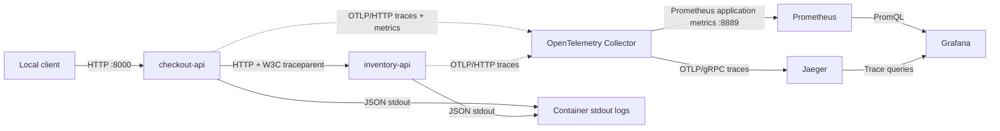

# Checkout Observability

Checkout Observability is a small, deterministic two-service system for exercising local observability workflows. `checkout-api` validates checkout requests and calls `inventory-api`, which reads a fixed in-memory catalog without decrementing stock. The repository includes distributed tracing, custom metrics, correlated JSON logs, provisioned dashboards, reproducible traffic, and bounded failure demonstrations.

## Architecture



Logs are correlated with traces but are not exported to Grafana or stored in a log backend.

## Components

| Component | Role |
| --- | --- |
| `checkout-api` | Public FastAPI service exposing `GET /health` and `POST /checkout`. |
| `inventory-api` | Internal FastAPI service exposing `GET /health` and `POST /check`. |
| OpenTelemetry Collector | Receives OTLP/HTTP, limits memory, batches signals, exports traces, and exposes application metrics. |
| Jaeger | Stores and displays local traces using transient in-memory storage. |
| Prometheus | Scrapes Collector-exported application metrics and stores local time series. |
| Grafana | Uses provisioned Prometheus and Jaeger data sources and a three-panel dashboard. |

## Prerequisites and pinned versions

- A maintained Fedora release with Docker Engine and Docker Compose v2.
- Python 3.11–3.14 for native development; Python 3.13 is used by CI and the lock files.
- OpenSSL for local credential generation.
- `curl` for API examples.

| Dependency or image | Version |
| --- | --- |
| Python container | `3.13.16-slim-bookworm` |
| FastAPI / httpx / Uvicorn | `0.140.10` / `0.28.1` / `0.53.0` |
| OpenTelemetry API, SDK, OTLP exporter | `1.45.1` |
| OpenTelemetry FastAPI and httpx instrumentation | `0.66b1` |
| OpenTelemetry Collector | `0.162.0` |
| Jaeger | `2.22.0` |
| Prometheus | `3.15.1` |
| Grafana | `13.3.0` |

Python dependencies are fully resolved in `requirements.lock` and `requirements.runtime.lock`. Container images are pinned by version and multi-platform digest in `compose.yaml` and the service Dockerfiles.

## Fresh-clone setup

Replace `OWNER` with the GitHub account or organization that owns the repository:

```bash
git clone https://github.com/OWNER/checkout-observability.git
cd checkout-observability

docker version
docker compose version

python3.13 -m venv .venv
.venv/bin/python -m pip install --requirement requirements.lock

install -d -m 700 .local-secrets
umask 077
openssl rand -hex 32 | tr -d '\n' > .local-secrets/grafana_admin_password

docker compose up --build --detach --wait --wait-timeout 180
```

On Fedora, the Compose bind mounts already use private `:Z` SELinux labels. Do not disable SELinux or the firewall. If Docker is installed but inactive, start it with:

```bash
sudo systemctl enable --now docker
```

The application does not load `.env` files itself. `.env.example` contains non-sensitive defaults and placeholders; prefer explicit environment variables for local overrides. Grafana reads its generated password through the documented secret-file setting and the password is never placed in Compose, provisioning, or an image layer.

## Local endpoints

| Endpoint | Published address |
| --- | --- |
| Checkout API and OpenAPI UI | `http://127.0.0.1:8000` and `http://127.0.0.1:8000/docs` |
| Grafana | `http://127.0.0.1:3000` |
| Prometheus | `http://127.0.0.1:9090` |
| Jaeger | `http://127.0.0.1:16686` |

Sign in to Grafana as `admin` with the password stored in `.local-secrets/grafana_admin_password`. Inventory, OTLP, Collector health, and Collector application-metrics ports are internal to the Compose network.

## API examples

Normal checkout:

```bash
curl --request POST http://127.0.0.1:8000/checkout \
  --header 'content-type: application/json' \
  --data '{"product_id":"SKU-001","quantity":2,"scenario":"normal"}'
```

Deterministic out-of-stock response:

```bash
curl --include --request POST http://127.0.0.1:8000/checkout \
  --header 'content-type: application/json' \
  --data '{"product_id":"SKU-001","quantity":2,"scenario":"out-of-stock"}'
```

Local-only slow and failure simulations:

```bash
curl --include --request POST http://127.0.0.1:8000/checkout \
  --header 'content-type: application/json' \
  --data '{"product_id":"SKU-001","quantity":2,"scenario":"slow"}'

curl --include --request POST http://127.0.0.1:8000/checkout \
  --header 'content-type: application/json' \
  --data '{"product_id":"SKU-001","quantity":2,"scenario":"error"}'
```

Compose enables these simulations only with `APP_ENV=local` and `ENABLE_LOCAL_SIMULATIONS=true`. They must not be enabled in shared environments.

## Inspecting observability signals

### Traces

Open Jaeger, select `checkout-api`, and search for `checkout.process`. A normal distributed trace contains:

1. checkout HTTP server span;
2. `checkout.process` manual span;
3. outbound httpx client span;
4. inventory HTTP server span;
5. `inventory.lookup` manual span.

W3C Trace Context propagates the parent decision between services. The local default is full capture:

```bash
OTEL_TRACES_SAMPLER=always_on
```

Parent-aware 25% head sampling is available through:

```bash
OTEL_TRACES_SAMPLER=parentbased_traceidratio \
OTEL_TRACES_SAMPLER_ARG=0.25 \
docker compose up --detach --force-recreate --wait inventory-api checkout-api
```

Custom request metrics continue counting independently of trace sampling.

### Metrics and dashboards

The checkout service exports:

- `checkout_requests_total`: validated checkout attempts, labeled by bounded `outcome` and `result` values;
- `checkout_request_duration_seconds`: an explicit-bucket histogram covering the same validated requests.

FastAPI validation failures produced before the handler, including `422` responses, are excluded.

Useful PromQL queries:

```promql
sum(rate(checkout_requests_total[1m]))

sum(rate(checkout_requests_total{result="error"}[1m]))
/
sum(rate(checkout_requests_total[1m]))

histogram_quantile(
  0.95,
  sum by (le) (rate(checkout_request_duration_seconds_bucket[1m]))
)
```

Grafana provisions the `Checkout Observability` dashboard with request-rate, error-ratio, and P95-latency panels. Histogram percentiles are bucket estimates, not exact request durations.

### Correlated stdout logs

```bash
docker compose logs --since 5m checkout-api inventory-api
```

Application events are one-line JSON records containing timestamp, severity, service identity, outcome, duration, and active trace/span IDs. Use a log's `trace_id` in Jaeger to locate the corresponding trace. These logs remain container stdout only; no OTLP logs pipeline, Loki service, or durable retention is configured.

## Traffic and verification

Generate a finite local traffic mix:

```bash
.venv/bin/python scripts/traffic.py \
  --target-url http://127.0.0.1:8000
```

The default run sends 20 requests with concurrency 4 and includes all four scenarios. It reports response counts and latency summaries; it is not a benchmark or production load test.

Run the complete application and observability verification:

```bash
.venv/bin/python scripts/verify_stack.py
```

Demonstrate bounded Collector and Jaeger outages, then restore the stack:

```bash
.venv/bin/python scripts/demonstrate_failures.py
```

Demonstrate approximate parent-aware sampling with 200 requests and restore `always_on`:

```bash
.venv/bin/python scripts/demonstrate_sampling.py
```

The scripts use bounded polling deadlines. The Collector's explicit 256-batch sending queue is in memory: it can bridge a short backend outage while the Collector remains alive, but it cannot guarantee delivery after a Collector crash.

## Configuration

| Variable | Compose default | Purpose |
| --- | --- | --- |
| `APP_ENV` | `local` | Runtime environment; simulations require `local`. |
| `ENABLE_LOCAL_SIMULATIONS` | `true` | Enables slow and error scenarios in this local stack. |
| `SIMULATED_DELAY_SECONDS` | `1.0` | Inventory delay for the slow scenario. |
| `INVENTORY_API_URL` | `http://inventory-api:8001` | Internal checkout dependency URL. |
| `INVENTORY_HTTP_TIMEOUT_SECONDS` | `2.0` | Checkout-to-inventory timeout. |
| `OTEL_EXPORTER_OTLP_TRACES_ENDPOINT` | Collector `/v1/traces` | Full OTLP/HTTP trace endpoint. |
| `OTEL_EXPORTER_OTLP_METRICS_ENDPOINT` | Collector `/v1/metrics` | Full OTLP/HTTP metrics endpoint. |
| `OTEL_TRACES_SAMPLER` | `always_on` | SDK head-sampling strategy. |
| `OTEL_TRACES_SAMPLER_ARG` | empty | Optional ratio argument. |
| `GRAFANA_ADMIN_USER` | `admin` | Local Grafana administrator name. |
| `GRAFANA_ADMIN_PASSWORD_FILE` | ignored local file | Host source for the Grafana secret-file mechanism. |

## Tests and CI

Run local code checks:

```bash
.venv/bin/python -m compileall -q services shared scripts tests
.venv/bin/python -m pytest
.venv/bin/python -m pip check
docker compose config --quiet
docker compose run --rm --no-deps --entrypoint /otelcol \
  otel-collector validate --config=/etc/otelcol/config.yaml
```

The GitHub Actions workflow has read-only repository permissions. It installs locked dependencies, compiles Python, runs tests, validates Compose and the pinned Collector configuration, builds both application images, starts the stack, executes `scripts/verify_stack.py`, and always stops project containers. The workflow requires no repository secrets and does not deploy or publish artifacts.

## Shutdown and data reset

Normal shutdown removes this project's containers and networks while preserving named volumes:

```bash
docker compose down --remove-orphans
```

The following command is intentionally destructive. It deletes this Compose project's Prometheus data, Grafana database, and prepared Grafana-secret volume:

```bash
docker compose down --volumes --remove-orphans
```

It does not prune global Docker resources. Jaeger traces are already transient and disappear when Jaeger stops.

## Troubleshooting

- **Docker daemon unavailable:** run `sudo systemctl enable --now docker`, then verify with `docker version`.
- **Grafana rejects the generated password:** the admin password is applied when Grafana initializes its database. If the password was missing or unreadable on first start, run the destructive project-data reset, regenerate the password file, and start again.
- **No metrics immediately after a request:** application metrics export every five seconds and Prometheus scrapes every two seconds. Generate traffic and use `scripts/verify_stack.py` instead of relying on a fixed sleep.
- **No trace during ratio sampling:** head sampling is probabilistic. Restore `OTEL_TRACES_SAMPLER=always_on` when every local trace is required.
- **Fedora bind-mount denial:** keep the repository's `:Z` labels and inspect SELinux audit output; do not disable SELinux.
- **Port already in use:** inspect local listeners on `8000`, `3000`, `9090`, and `16686` before changing published ports.

## Limitations

- Local telemetry uses plaintext inside an isolated development network; there is no TLS or service-to-service authentication.
- Inventory is a fixed in-memory catalog, stock is not decremented, and there is no real payment integration or database.
- Jaeger uses in-memory storage. Prometheus and Grafana persist only in local Docker volumes.
- Logs are correlated stdout records without durable storage or an OTLP log pipeline.
- Collector and SDK queues are memory-only and do not provide crash-safe delivery.
- The Collector Prometheus exporter and Python instrumentation packages used here are pre-stable components.
- There is no high availability, alerting, tail-sampling deployment, production capacity claim, Kubernetes, or cloud deployment.

## Official documentation

- [Docker Engine on Fedora](https://docs.docker.com/engine/install/fedora/)
- [Docker Compose installation](https://docs.docker.com/compose/install/)
- [OpenTelemetry Python exporters](https://opentelemetry.io/docs/languages/python/exporters/)
- [OpenTelemetry Collector configuration](https://opentelemetry.io/docs/collector/configuration/)
- [OpenTelemetry SDK sampling configuration](https://opentelemetry.io/docs/languages/sdk-configuration/general/)
- [Jaeger 2.22 documentation](https://www.jaegertracing.io/docs/2.22/)
- [Prometheus installation](https://prometheus.io/docs/prometheus/latest/installation/)
- [Grafana Docker configuration and secret files](https://grafana.com/docs/grafana/latest/setup-grafana/configure-docker/)
- [Grafana provisioning](https://grafana.com/docs/grafana/latest/administration/provisioning/)
